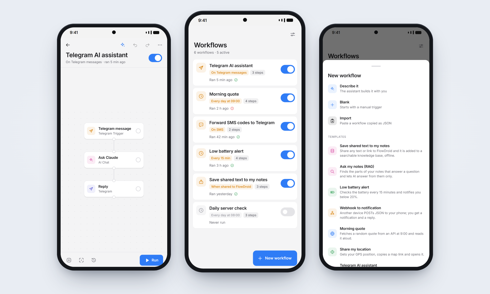

  

<h1 align="center">FlowDroid</h1>

  Automations that run on your Android phone. No server, no subscription.

  
  
  
  
  
  

  

---

FlowDroid turns your phone into its own automation hub. You build a
workflow by placing steps on a canvas and connecting them, one after the
other. The first step waits for something to happen, like a new text
message, a certain time of day, or arriving home. Every step after it does
something: sends a message, asks an AI a question, saves a note, or changes
a setting on your phone.

Most automation tools run on someone else's computer in the cloud. FlowDroid
runs entirely on your phone, so your messages, files and passwords never
leave it, and there's nothing to host or pay for.

## What it can do

**Start a workflow when**
a time or schedule comes up, a text or notification arrives, you arrive at
or leave a place, a calendar event is about to start, you share something to
the app, you tap a shortcut, or another app or website sends a request.

**Use your phone** to
show notifications, speak out loud or listen to you, set alarms and timers,
find and add contacts, read and add calendar events, take photos or scan
documents, check the battery and location, and switch sound modes.

**Connect to your apps** like
Telegram, Discord, Gmail and email, Google Sheets, Drive and Calendar,
Notion, Airtable and Supabase, or any service that has a web API.

**Work with AI** from
Claude, ChatGPT, Gemini or a model running on your own computer. An AI step
can answer questions, write messages, read images, or use other tools to get
a job done.

**Handle websites** with a built-in browser that can click, type, read
text off a page and take screenshots. Log in once, and later runs stay
logged in.

**Go further** with JavaScript or Python code, phone commands, and a
complete Ubuntu Linux system that runs inside the app without rooting your
phone.

See the [full feature list](docs/features.md) for everything in detail.

## Built-in assistant

You don't have to build workflows by hand. Open the assistant in the editor
and describe what you want, for example *"every weekday at 8, text me the
weather"*. It adds the steps, connects them and fills in the settings. You
can keep chatting to change things, and it always asks before running
anything. It works with your own Claude, ChatGPT or Gemini account.

## Why run automations on your phone

- **Private.** There is no FlowDroid server. Your workflows and data stay on
  the device, and passwords are kept in Android's encrypted storage.
- **Free.** No hosting and no monthly fee. You only pay for services you
  choose to connect, such as an AI provider.
- **It can do more.** A cloud service can't see your texts, know where you
  are or buzz your pocket. FlowDroid can, because it lives where those things
  happen.
- **It keeps going.** Workflows keep running in the background, after
  restarts and app updates. A setup screen guides you through your phone's
  battery settings so Android doesn't stop it.

## Get started

1. Download the APK from the [releases page](https://github.com/seph1709/flowdroid/releases)
   and install it on your Android phone.
2. Tap **New workflow**, or start from one of the ready-made templates.
3. Add your steps and tap **Run** to try it out. Each step shows what came
   in and what went out, so it's easy to see what happened.
4. Switch the workflow on, and it runs by itself from then on.

FlowDroid is in beta and isn't on the Play Store yet. To build the app yourself instead,
follow the [developer guide](docs/development.md).

## Good to know

- FlowDroid works on Android only.
- It's still early, so back up your workflows from Settings now and then.
- Some phone brands are strict about apps running in the background. The
  app shows you the exact steps for your phone.

## Contributing

Ideas, bug reports and pull requests are welcome. See
[CONTRIBUTING.md](CONTRIBUTING.md) to get started, and
[SECURITY.md](SECURITY.md) to report a security problem privately.

## License

FlowDroid is free and open source under the [MIT License](LICENSE).
